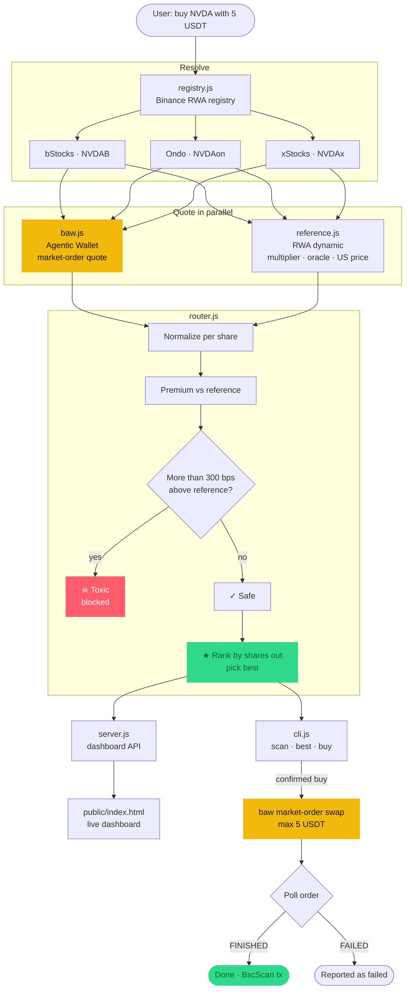
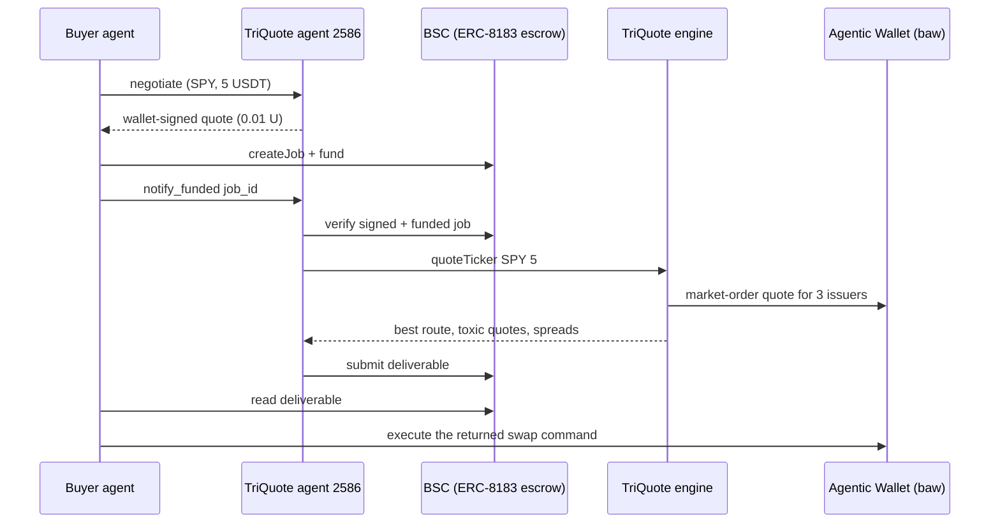

# TriQuote

**One ticker. Three issuers. The cheapest *safe* fill on BNB Chain.**

TriQuote is a best-execution router and toxic-quote shield for tokenized US stocks on BNB Smart Chain. For any ticker it quotes every issuer that lists it — **bStocks**, **Ondo** and **xStocks** — through **Binance Agentic Wallet**, normalizes each quote by the token's live share multiplier, checks it against an independent reference price, blocks toxic fills, and routes the order to the cheapest safe issuer.

Built for **BNB Hack: Tokenized Stocks Edition**.

---

## Why this exists

On BSC the same stock exists as several different tokens. NVIDIA alone is `NVDAB` (bStocks), `NVDAon` (Ondo) and `NVDAx` (xStocks). A user who just wants "NVIDIA" faces three problems the wallet does not solve for them:

1. **Prices differ between issuers.** Liquidity is fragmented, so the same dollar buys a different number of shares depending on the token.
2. **Tokens are not 1 share.** Each token carries a *share multiplier* (cumulative dividend reinvestment, splits). Comparing raw token amounts picks the wrong issuer.
3. **Some quotes are toxic.** Off-hours liquidity is thin, and a quote can come back `success: true` at a price that would wipe out most of the order.

## What we observed (live, Saturday 10 Oct 2026, US market off-hours)

All numbers below were produced by TriQuote against BSC mainnet for a 5 USDT order.

| Finding | Detail |
|---|---|
| **Toxic quote returned as success** | `SPYx` quoted at **$8,912 / share** vs a US reference of **$779.87**. Routing there would lose **$4.57 of $5 (91%)**. `baw market-order quote` returned `success: true` with no warning. TriQuote flagged and blocked it. |
| **Multiplier flips the winner** | On SPY, META, QQQ and AAPL the issuer that returns the most *tokens* is **not** the issuer that returns the most *shares*. |
| **Off-hours discount** | Best safe SPY route (`SPYon`) filled **74 bps below** the last US price. |
| **Fragmented coverage** | Binance's registry lists **40 tickers on all three issuers** and **121 on at least two** on BSC. |
| **xStocks liquidity gap** | **9 of 10** xStocks tokens in our watchlist returned `No liquidity available` during off-hours. |
| **Safe-issuer spreads** | Up to **~49 bps** between the two safe issuers on the same ticker (SPY, MSFT). |

## Features

- **Cross-issuer radar** — scans a watchlist (or every multi-issuer ticker) and ranks by spread.
- **Per-share normalization** — `pricePerShare = usdtIn / (tokensOut × multiplier)`, using the live multiplier from Binance.
- **Reference price** — US last price from Binance's tokenized-securities API, falling back to the median oracle price per share.
- **Toxic-quote shield** — any quote more than **300 bps** above reference is excluded from routing and reported with the loss it would have caused.
- **Best-route execution** — buys the cheapest safe issuer via `baw market-order swap`, hard-capped at **5 USDT**, dry-run by default, and only reported as done once the order reaches `FINISHED`.
- **Live dashboard** — local web UI with KPIs, per-issuer cells (★ BEST / ☠ TOXIC / NO LIQUIDITY) and an execution log.
- **Agent-to-agent service** — a BNB Agent Studio seller agent (ERC-8004 identity **#2586**) that sells TriQuote route reports to other agents over A2A and MCP, paid through ERC-8183 escrow.

## Binance Web3 stack used

| Component | How TriQuote uses it |
|---|---|
| **Agentic Wallet (`baw` CLI)** | `market-order quote` for every issuer, `market-order swap` for execution, `market-order list` to poll to a terminal state, `wallet status` before trading |
| **Tokenized securities registry** | `.../rwa/stock/detail/list/ai` — maps each ticker to its bStocks / Ondo / xStocks contracts and multipliers on BSC |
| **Tokenized securities dynamic data** | `.../rwa/dynamic/ai` — live share multiplier, oracle token price, US stock price and market status per token |
| **BNB Agent Studio (`bag` CLI)** | Seller agent scaffold, ERC-8004 identity registration, ERC-8183 signed quotes and escrowed delivery, A2A + MCP faces |

## Architecture



| File | Responsibility |
|---|---|
| `src/registry.js` | Fetches and caches the tokenized-stock registry, groups BSC listings by ticker |
| `src/baw.js` | Thin wrapper over the `baw` CLI with latency measurement and order polling |
| `src/reference.js` | Reference price, live multipliers and market status per issuer |
| `src/router.js` | Quotes all issuers in parallel, normalizes, flags toxic quotes, ranks routes |
| `src/cli.js` | `scan`, `best`, `buy` commands |
| `src/server.js` | Local HTTP API + dashboard server |
| `public/index.html` | Dashboard UI (no external dependencies) |

## TriQuote as an agent (BNB Agent Studio)

`triquoteagent/` is a BNB Agent Studio seller agent that turns TriQuote into a service other AI agents can discover, pay and call. Instead of an LLM, its work hook runs the TriQuote engine and returns a structured route report.

| Item | Value |
|---|---|
| ERC-8004 identity | **Agent #2586** on BSC testnet, registry `eip155:97:0x8004A818BFB912233c491871b3d84c89A494BD9e` |
| Agent wallet | `0xF2cb1E553a98705C0b00774DC4a3e015324115e5` |
| Faces | A2A (`/.well-known/agent-card.json`) and MCP (`/mcp`) |
| Commerce rail | ERC-8183 escrow on BSC testnet, **0.01 U per route report** |
| Work hook | `triquoteagent/app/agent/src/triquoteWork.ts` → `src/router.js` |



The agent sells **route intelligence**, not execution: the report ends with the exact `baw market-order swap` command, so the buyer executes in its own Agentic Wallet and never hands over funds.

Example deliverable (live, 10 Oct 2026):

```json
{
  "service": "TriQuote best-execution route",
  "ticker": "SPY",
  "usdt": 5,
  "reference": { "price": 780.075, "source": "us-stock-last", "marketStatus": "offhours" },
  "verdict": "Route 5 USDT to SPYon (Ondo)",
  "bestRoute": { "issuer": "Ondo", "symbol": "SPYon", "pricePerShare": 774.2867, "premiumVsReferenceBps": -74 },
  "routes": [
    { "issuer": "Ondo", "symbol": "SPYon", "status": "best", "pricePerShare": 774.2867, "premiumVsReferenceBps": -74 },
    { "issuer": "xStocks", "symbol": "SPYx", "status": "toxic", "pricePerShare": 8912.2702, "premiumVsReferenceBps": 104249, "lossIfRoutedUsd": 4.5656 },
    { "issuer": "bStocks", "symbol": "SPYB", "status": "safe", "pricePerShare": 778.0066, "premiumVsReferenceBps": -27 }
  ],
  "toxicBlocked": ["SPYx"],
  "executeWith": "baw market-order swap --fromTokenQty 5 --fromToken 0x55d3...7955 --toToken 0x6a70...331a --binanceChainId 56 --json"
}
```

### Run the agent

Requires Node.js 22+, pnpm 10 and the Agent Studio CLI.

```bash
npm install -g @bnbagent/studio-cli
cd triquoteagent
pnpm install
cd app/agent
bag wallet new --generate-password
bag doctor
cd ../..
bag dev
```

Ask the agent for a signed quote:

```bash
curl -s http://localhost:9000/ -H 'Content-Type: application/json' -d '{"jsonrpc":"2.0","id":1,"method":"message/send","params":{"message":{"kind":"message","messageId":"tq-1","role":"user","parts":[{"kind":"data","data":{"skill":"negotiate","task_description":"{\"ticker\":\"SPY\",\"usdt\":5}","terms":{"deliverables":"TriQuote route report","quality_standards":"All issuers quoted"}}}]}}}'
```

## Run it

### Prerequisites

- Node.js **20+**
- Binance Agentic Wallet CLI **1.10.0+**
- An Agentic Wallet created in the Binance App and signed in on this machine

```bash
npm install -g @binance/agentic-wallet
baw auth signin --json
baw auth verify --qrCodeId <qrCodeId from signin> --json
baw wallet status --json
```

Quoting does **not** require any balance. Executing a buy requires USDT (and a little BNB for gas) on **BSC** in the Agentic Wallet.

### Install

```bash
git clone https://github.com/0xR-1/TriQuote.git
cd TriQuote
```

No `npm install` is needed — TriQuote has zero runtime dependencies.

### CLI

```bash
node src/cli.js best SPY
node src/cli.js scan
node src/cli.js scan NVDA TSLA AAPL --usdt 5
node src/cli.js scan --all
node src/cli.js buy NVDA --usdt 5
node src/cli.js buy NVDA --usdt 5 --confirm
```

`buy` without `--confirm` is a dry run: it shows the route it *would* take and stops.

Example output (`best SPY`, 10 Oct 2026):

```
SPY  ·  5 USDT  ·  2 safe / 3 live / 3 listed
  ref $779.87 (US last price) · market offhours
  ★ Ondo     SPYon         $774.0884 /share      -74 bps vs ref   x1.009473   3835ms
  ☠ xStocks  SPYx         $8912.3343 /share  +104280 bps vs ref   x1.005715   3191ms   TOXIC · would lose $4.57
  · bStocks  SPYB          $777.8106 /share      -26 bps vs ref   x1.001730   3179ms
  spread 48.1 bps between safe issuers · best vs worst saves $0.0239
  best route is 74 bps BELOW the reference price
  blocked 1 toxic quote(s) priced >300 bps over reference · avoided losing up to $4.57
  ! raw token amounts point to a different issuer; share multipliers change the winner
```

### Dashboard

```bash
node src/server.js
```

Open <http://localhost:4173>. The first scan of 10 tickers takes roughly 15–30 seconds; results are cached for 60 seconds.

## Safety

- Every live trade is capped at **5 USDT** in code.
- `buy` is a **dry run** unless `--confirm` is passed.
- Toxic quotes are **never** routed. If every live issuer is toxic, `buy` refuses.
- A swap is reported as successful **only** after `baw market-order list` shows `FINISHED`; an `orderId` alone is treated as "submitted".
- No API keys, private keys or wallet secrets are read or stored by TriQuote. Wallet authentication is handled entirely by the `baw` CLI.

## Known limitations

We prefer to state these plainly:

- **Runs locally.** Quoting and execution go through the `baw` CLI, which needs a signed-in Agentic Wallet session on the same machine. There is no hosted deployment.
- **Quotes are indicative, not firm.** The executed price can differ from the quote within the slippage tolerance.
- **The toxic threshold (300 bps) is a heuristic.** It is tuned to catch broken off-hours fills, not small premiums.
- **Off-hours reference.** When the US market is closed the reference is the *last* US price, so a genuine weekend move can look like a premium or discount.
- **Two sources disagree on multipliers.** The registry reported `SPYx` multiplier `1`, while the dynamic endpoint reported `1.0057`. TriQuote prefers the dynamic value and falls back to the registry.
- **Unknown issuer types ignored.** The registry also returned `type` values `4` and `9`, which are undocumented; TriQuote only routes types 1 (Ondo), 2 (xStocks) and 3 (bStocks).
- **Buy only.** There is no sell or rebalance route yet.
- **Latency.** Each quote takes ~1.7–3.8 s; a full `--all` scan quotes hundreds of routes and is slow.
- **Live execution status:** see the execution log in the dashboard. If it is empty, no live swap has been run from this repository yet.
- **Agent runs on testnet and locally.** The Agent Studio agent is registered on BSC testnet with a `localhost` endpoint; it was not deployed to a public runtime (the managed platform requires Bun and is a 48-hour testnet trial). Its quotes still come from BSC mainnet through `baw`.
- **x402 rail not enabled.** B402 merchant credentials are issued only after manual approval, so the agent uses the ERC-8183 escrow rail instead.
- **No completed paid job yet.** Negotiation (wallet-signed quote) and the work hook were verified live; an end-to-end funded ERC-8183 job was not completed because the testnet U faucet had hit its monthly limit.

## License

MIT
